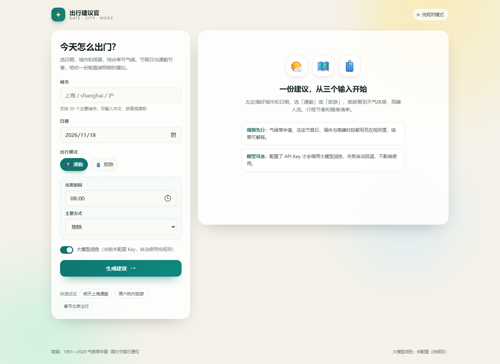
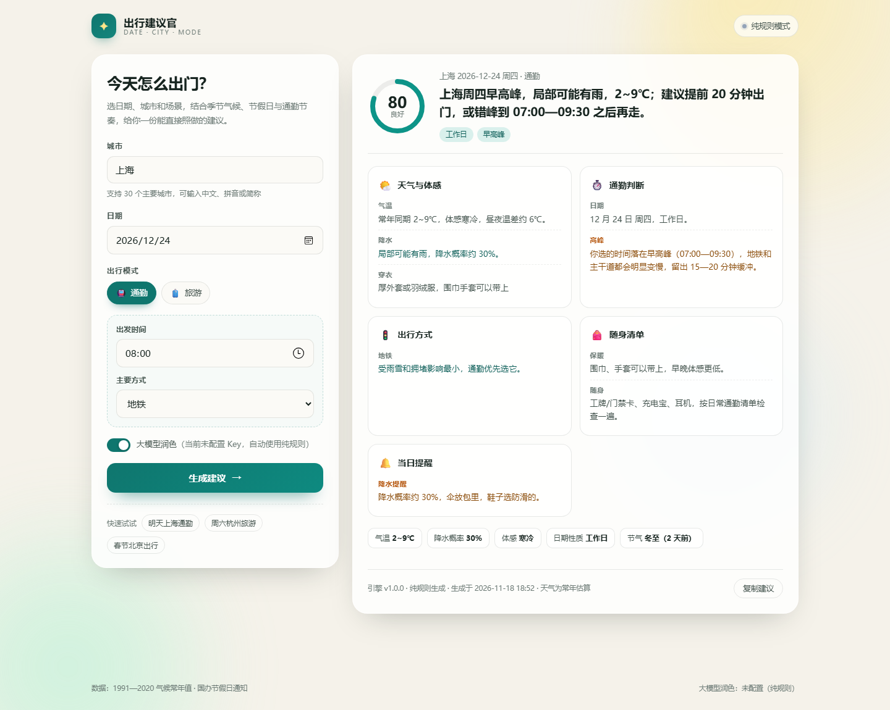
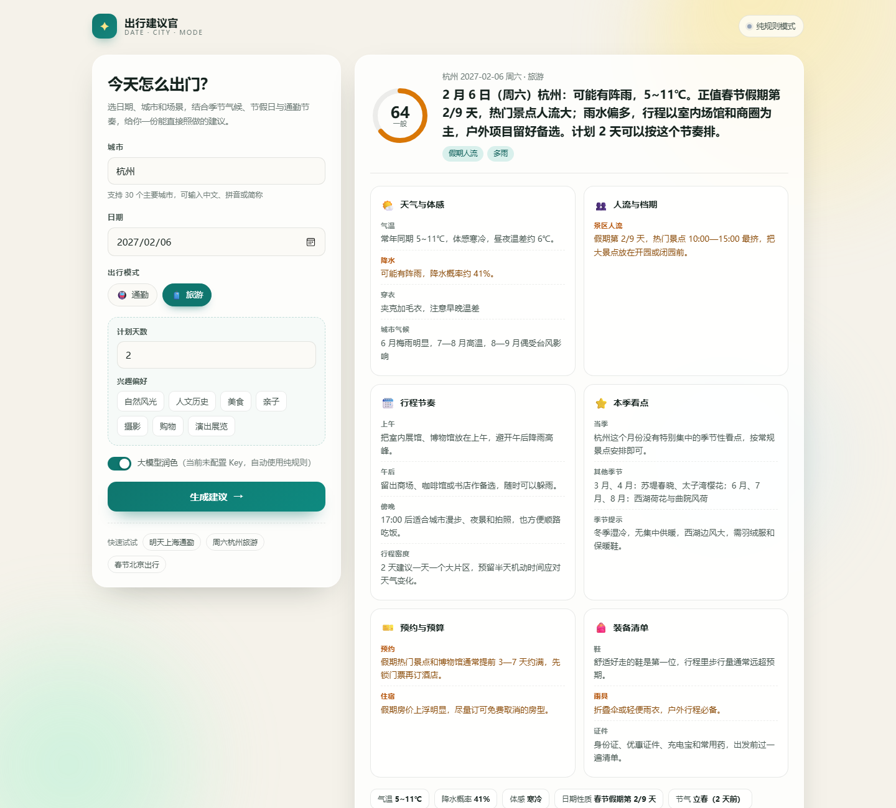
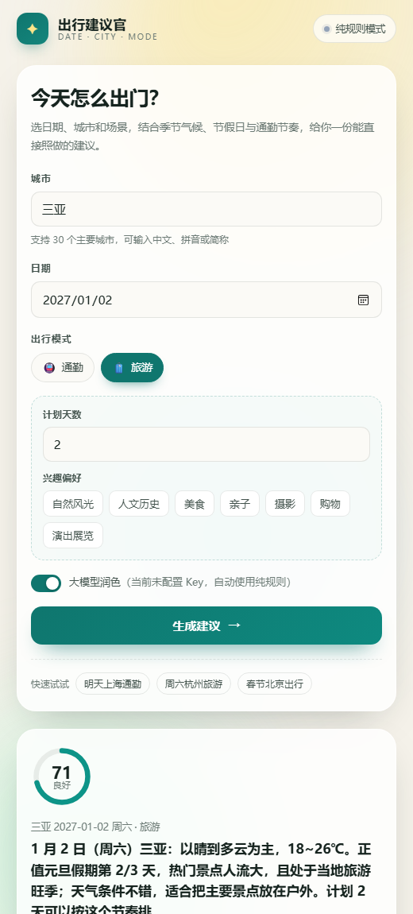

# 出行建议官 · Travel Advisor

输入 **日期 + 城市 + 出行模式**，返回一份可解释、能直接照做的出行建议。
规则引擎负责事实（气候、节假日、高峰、人流），大模型只负责把结论说得更自然——没配置 Key 也能完整使用。



[](https://render.com/deploy?repo=https://github.com/aaa1173188435/travel-advisor)

## 特点

- **三种输入，结构固定**：`date` / `city` / `mode`，输出是稳定的 JSON（摘要 + 评分 + 分区建议 + 事实明细），前端和第三方都能直接消费。
- **规则可解释**：每条建议都能追溯到具体规则（降水概率、假期第几天、是否早高峰），不是模型自由发挥。
- **天气可接真实预报**：配置和风天气后，预报窗口内的日期用真实预报，超出窗口或接口失败自动回退气候常年值，并在响应里标明来源。
- **模式可扩展**：新增一种场景 = 新增一个 `Mode` 子类 + 一行 import，前端会自动出现新的模式按钮和它声明的附加选项。
- **大模型可选**：配置 Key 后多一段「编辑润色」；调用失败、超时或没 Key 时自动降级，接口不报错。
- **零前端构建**：原生 HTML/CSS/JS，由 FastAPI 直接托管，`python -m travel_advisor` 就能跑。

| 通勤 | 旅游 |
| --- | --- |
|  |  |



## 快速开始

要求 Python 3.10+。

```powershell
cd travel-advisor
python -m pip install -r requirements.txt
python -m travel_advisor
# 打开 http://127.0.0.1:8010
```

开发模式（改动自动重载）：

```powershell
.\scripts\dev.ps1 -Reload
```

也可以直接用 uvicorn：

```powershell
python -m uvicorn travel_advisor.app:app --host 127.0.0.1 --port 8010 --reload
```

页面支持分享链接，例如：

```
http://127.0.0.1:8010/?city=上海&date=2026-12-24&mode=commute
```

## API

### `POST /api/advice`

```powershell
curl -X POST http://127.0.0.1:8010/api/advice `
  -H "Content-Type: application/json" `
  -d '{"city":"上海","date":"2026-12-24","mode":"commute","options":{"depart_time":"08:30","transport":"subway"}}'
```

请求字段：

| 字段 | 类型 | 说明 |
| --- | --- | --- |
| `city` | string | 城市名，支持中文、全拼、首字母、常见别称 |
| `date` | `YYYY-MM-DD` | 出行日期，范围 1970—2100 |
| `mode` | string | 模式 id，当前为 `commute` / `travel` |
| `options` | object | 模式专属选项，见 `GET /api/modes` 的 `options` |
| `use_llm` | bool | 是否尝试大模型润色，默认 `true` |

响应结构（节选）：

```json
{
  "request": { "city": "上海", "date": "2026-12-24", "mode": "commute", "options": {} },
  "city": { "name": "上海", "matched": true, "has_subway": true },
  "date": { "weekday": "周四", "day_type": "workday", "type_label": "工作日" },
  "result": {
    "headline": "上海周四早高峰，局部可能有雨，2~9℃；建议提前 20 分钟出门……",
    "score": 80,
    "score_label": "良好",
    "tags": ["工作日", "早高峰"],
    "sections": [
      {
        "id": "weather",
        "title": "天气与体感",
        "icon": "🌤️",
        "items": [{ "label": "气温", "text": "常年同期 2~9℃，体感寒冷……", "level": "info" }]
      }
    ]
  },
  "facts": { "weather": { "t_min": 2.5, "t_max": 9.2, "rain_prob": 0.3 }, "calendar": {} },
  "polish": { "used": false, "text": null, "model": null, "error": null },
  "warnings": [],
  "meta": { "engine_version": "1.0.0", "generated_at": "2026-11-18T18:00:00+08:00" }
}
```

`level` 取值：`good` / `info` / `warn` / `bad`，前端据此着色。

### 其它接口

| 方法 | 路径 | 说明 |
| --- | --- | --- |
| `GET` | `/api/modes` | 模式列表 + 每个模式的附加选项声明 |
| `GET` | `/api/cities?q=shang&limit=8` | 城市搜索（联想输入用） |
| `GET` | `/api/health` | 健康检查、模式列表、大模型状态 |
| `GET` | `/` | 单页前端 |

未知 `mode` 返回 `422`，响应里带 `available_modes`。

## 项目结构

```
travel-advisor/
├─ travel_advisor/
│  ├─ app.py              # FastAPI 路由与静态托管
│  ├─ engine.py           # 编排：上下文 → 模式 → 润色 → 响应
│  ├─ context.py          # 请求 → AdviceContext（日期/城市/天气/假期事实）
│  ├─ holidays.py         # 法定节假日、调休、下个假期
│  ├─ solar.py            # 二十四节气（近似）与季节
│  ├─ cities.py           # 城市档案、模糊匹配、兜底
│  ├─ weather.py          # 天气画像：预报优先，常年值兜底
│  ├─ weather_api.py      # 和风天气接口、缓存与失败降级
│  ├─ llm.py              # OpenAI 兼容润色，失败降级
│  ├─ registry.py         # 模式注册表
│  ├─ schema.py           # Pydantic 请求校验
│  ├─ modes/
│  │  ├─ base.py          # Mode / Section / Item / 评分工具
│  │  ├─ commute.py       # 通勤模式
│  │  ├─ fitness.py       # 健身模式
│  │  └─ travel.py        # 旅游模式
│  └─ data/
│     ├─ cities.json      # 31 个城市的气候与看点
│     └─ holidays_cn.json # 2026 / 2027 官方放假安排
├─ web/                   # index.html / styles.css / app.js
├─ tests/                 # 44 个用例
├─ scripts/dev.ps1
├─ scripts/deploy_hf.py   # 一键发布到 Hugging Face Spaces
├─ scripts/deploy_modelscope.py  # 一键发布到魔搭 Docker 创空间
├─ deploy/modelscope/     # 魔搭专用 Dockerfile（7860 端口）与 README
├─ Dockerfile             # 通用容器镜像
└─ render.yaml            # Render 一键部署蓝图
```

## 规则引擎做了什么

**日期事实**：工作日 / 周末 / 法定假期 / 调休上班日、假期第几天、距下一个假期多少天、临近节气。2026、2027 年使用国办通知原文；其它年份按固定日期估算并标记 `estimated`。

**天气画像**：优先调用和风天气的日预报（若已配置）；未配置、日期超出预报窗口或接口失败时，取城市 12 个月的气候常年值按日期线性插值，得到当日最高/最低气温与降水概率，再换算体感、穿衣建议、是否需要带伞。响应里的 `weather.source` 会标明 `forecast` 还是 `climate`，`weather.estimated` 为 `false` 时即为真实预报。

**通勤模式**：早高峰 07:00—09:30、晚高峰 17:00—19:30；叠加降水、高温、严寒、限行、所选交通方式，给出时间缓冲、替代方案、随身清单，并计算 0—100 的出行指数。

**旅游模式**：假期档期（首日出城 / 末日返程 / 中间景区人流）、目的地旺季、当季看点、按天数给行程密度、预约与预算提醒、装备清单。

**健身模式**：按运动项目（跑步 / 骑行 / 户外训练 / 球类 / 健身房 / 游泳）、时长、强度、开始时间，区分室内外：户外看降水、高温、严寒与路面，室内看器械高峰；给出最佳时段、热身/主训练/放松拆分、装备与安全提醒。

评分是规则加权的结果（雨雪、极端温度、高峰、假期人流扣分，错峰加分），因此同一份建议里的结论与分数始终一致。

## 新增一种出行模式

以「自驾」为例，三步：

**1. 新建 `travel_advisor/modes/driving.py`**

```python
from ..context import AdviceContext
from ..registry import register
from .base import Item, Mode, ModeResult, Section, clamp, score_label


class DrivingMode(Mode):
    id = "driving"
    name = "自驾"
    icon = "🚗"
    description = "自驾出行，关注路况、车流与停车"
    options = [
        {"key": "depart_time", "label": "出发时间", "type": "time", "default": "09:00"},
        {
            "key": "road", "label": "道路类型", "type": "select", "default": "city",
            "choices": [
                {"value": "city", "label": "市区"},
                {"value": "highway", "label": "高速"},
            ],
        },
    ]

    def advise(self, ctx: AdviceContext) -> ModeResult:
        score = 90
        if ctx.weather.rain_prob >= 0.35:
            score -= 15
        if ctx.holiday.is_holiday:
            score -= 10
        score = clamp(score)
        sections = [
            Section("weather", "天气与路况", "🌧️", [
                Item("降水", f"降水概率约 {round(ctx.weather.rain_prob * 100)}%", "warn"),
            ]),
        ]
        return ModeResult(
            mode_id=self.id,
            mode_name=self.name,
            headline=f"{ctx.city.name} 自驾：注意车流与天气。",
            score=score,
            score_label=score_label(score),
            tags=["自驾"],
            sections=sections,
        )


register(DrivingMode())
```

**2. 在 `travel_advisor/modes/__init__.py` 里加一行 import**

```python
from . import commute, driving, travel  # noqa: F401
```

**3. 完成。** 打开页面，模式栏会多出「🚗 自驾」，`options` 里声明的出发时间、道路类型会自动渲染成对应控件；`GET /api/modes` 与 `POST /api/advice` 立即可用。

`options` 支持的类型：`time`、`select`（需 `choices`）、`number`（可带 `min` / `max`）、`multi`（多选，需 `choices`）。新增字段只需在 `normalize_options` 里做一次收敛，前端不用改。

## 真实天气（可选，和风天气）

不配置时全程使用气候常年值。接入和风后，**预报窗口内**的日期会用真实预报。

1. 在 [和风天气控制台](https://console.qweather.com) 创建项目，拿到 32 位 Key；
2. 在控制台「设置 → API Host」复制你账号的专属域名（形如 `https://abc123.re.qweatherapi.com`）；
3. 写进 `.env`：

```ini
TRAVEL_ADVISOR_WEATHER_KEY=你的32位Key
TRAVEL_ADVISOR_WEATHER_BASE_URL=https://abc123.re.qweatherapi.com
```

4. 重启服务，`GET /api/health` 里应看到 `"weather": {"enabled": true, ...}`。

> 注意：公共域名 `devapi.qweather.com` / `api.qweather.com` 已不能用于新账号，会返回 `403 Invalid Host`，必须用控制台里的专属 API Host。地址只填域名也可以，代码会自动补 `https://`，并忽略误粘贴的 `/v7/...` 路径。

**Key 的位置**：所有 Key 只在服务端（本地 `.env` 或托管平台的环境变量）读取，浏览器拿不到；`.env` 被 `.gitignore` 排除，从未进入 git 历史。若把服务部署到公网，可以只填天气 Key、不填 `DEEPSEEK_API_KEY`，或设置 `TRAVEL_ADVISOR_LLM_ENABLED=0`，这样大模型层完全不启用，规则与天气照常工作。

| 变量 | 默认值 | 说明 |
| --- | --- | --- |
| `TRAVEL_ADVISOR_WEATHER_KEY` | 空 | 和风 Key；留空则只用常年值 |
| `TRAVEL_ADVISOR_WEATHER_BASE_URL` | 空 | 和风 API Host，不带 `/v7` |
| `TRAVEL_ADVISOR_WEATHER_TIMEOUT` | `6` | 秒 |

行为约定：

- **窗口限制**：先请求 7 天预报，失败再试 3 天；超出窗口的日期回退常年值，不报错。
- **失败降级**：主机错误、鉴权失败、超时都会回退，并在 `warnings` 里说明原因；失败结果缓存 60 秒，避免每次请求都卡在网络上。
- **来源可查**：`facts.weather.source` 为 `forecast` 或 `climate`，同时带 `provider`、`observed_at`、`estimated`；页面底部会显示「天气来源」。
- **降水概率**：和风日预报只给天气现象和降水量，代码按「小雨 55% / 中雨 70% / 大雨 85% / 晴 5%」这类规则换算，属于估算值。

## 配置大模型 API Key

规则结果先算好，再把 `facts` 与草稿交给模型，只允许它改写结论、不允许编造数据。提示词里明确约束：最多 2—3 句、不超过 120 字、必须点明风险。

默认接 DeepSeek（OpenAI 兼容协议）。Key 在 [platform.deepseek.com/api_keys](https://platform.deepseek.com/api_keys) 创建，形如 `sk-...`。

### 方式一：写进 `.env`（推荐）

```powershell
cd travel-advisor
Copy-Item .env.example .env
notepad .env
```

把 `TRAVEL_ADVISOR_LLM_API_KEY=` 后面填上你的 Key，保存后重启服务：

```powershell
python -m travel_advisor
```

`.env` 会被自动读取（不覆盖已存在的环境变量），且已在 `.gitignore` 中，不会被提交。

### 方式二：当前终端临时生效

```powershell
$env:TRAVEL_ADVISOR_LLM_API_KEY = "sk-..."
python -m travel_advisor
```

关掉这个终端就失效，适合临时试一下。

### 方式三：永久写入当前用户环境变量

```powershell
setx TRAVEL_ADVISOR_LLM_API_KEY "sk-..."
```

`setx` 不影响已打开的终端，需要**重开一个终端**再启动服务。

### 验证是否生效

页面右上角的状态从「纯规则模式」变成「大模型已连接」，结果区出现「编辑润色」段落；或者直接查接口：

```powershell
curl http://127.0.0.1:8010/api/health
# "llm": { "enabled": true, "model": "deepseek-chat", "base_url": "https://api.deepseek.com/v1" }
```

### 换成其它兼容服务

```powershell
$env:TRAVEL_ADVISOR_LLM_BASE_URL = "https://api.openai.com/v1"
$env:TRAVEL_ADVISOR_LLM_MODEL = "gpt-4o-mini"
```

| 变量 | 默认值 | 说明 |
| --- | --- | --- |
| `TRAVEL_ADVISOR_LLM_ENABLED` | `1` | 设为 `0` 可整体关闭大模型调用（公网部署防刷） |
| `TRAVEL_ADVISOR_LLM_API_KEY` | 空 | 留空则纯规则；也兼容 `DEEPSEEK_API_KEY` |
| `TRAVEL_ADVISOR_LLM_BASE_URL` | `https://api.deepseek.com/v1` | 任意 OpenAI 兼容地址 |
| `TRAVEL_ADVISOR_LLM_MODEL` | `deepseek-chat` | 模型名 |
| `TRAVEL_ADVISOR_LLM_TIMEOUT` | `12` | 秒；超时或报错自动降级 |

优先级：进程环境变量 > `.env`。修改 `.env` 或环境变量后需要重启服务（配置在进程启动时读取）。

调用失败时 `polish.used=false`、`polish.error` 记录原因，其余结果照常返回；单次请求也可以用 `"use_llm": false` 跳过润色。

## 部署（公网 / 手机访问）

前端是纯静态文件，可以放 GitHub Pages；**后端是 FastAPI，Pages 跑不了 Python**，需要 Render 或任意 Docker 主机。两者组合，就能得到一个 `github.io` 链接 + 完整功能。

### 第一步：Render 部署后端（必需）

仓库里已经带了 `Dockerfile` 和 `render.yaml`，点几下就能上线（也可以直接点 README 顶部的 Deploy 按钮）：

1. 用 GitHub 账号登录 [render.com](https://render.com)；
2. **New → Blueprint**，选择 `travel-advisor` 仓库，Render 会自动读取 `render.yaml`；
3. 在环境变量里填：
   - `TRAVEL_ADVISOR_WEATHER_KEY`：和风 Key
   - `TRAVEL_ADVISOR_WEATHER_BASE_URL`：和风 API Host
   - `DEEPSEEK_API_KEY`：大模型 Key（可留空；担心额度就留空或设 `TRAVEL_ADVISOR_LLM_ENABLED=0`）
4. Apply，等构建完成，得到形如 `https://travel-advisor-xxxx.onrender.com` 的地址。

注意：Render 免费实例 15 分钟无访问会休眠，再次访问约 30 秒冷启动；这是免费方案的正常现象。

### 备选：Hugging Face Spaces（免费、不用绑卡）

如果不想在 Render 绑支付方式，可以发布到 Hugging Face Spaces 的免费 Docker Space：

1. 登录 [huggingface.co](https://huggingface.co)，在 **Settings → Access Tokens** 创建一个 **Write** 权限的 token；
2. 在项目根目录新建 `.hf_token` 文件，把 token 粘进去（一行，已被 `.gitignore` 忽略）；
3. 运行：

```powershell
python scripts/deploy_hf.py
```

脚本会自动创建 Space、生成精简目录并推送代码，最后输出：

```
https://<你的用户名>-travel-advisor.hf.space
```

4. 打开 Space → **Settings → Variables and secrets**，添加三个 Secret：
   - `TRAVEL_ADVISOR_WEATHER_KEY`
   - `TRAVEL_ADVISOR_WEATHER_BASE_URL`
   - `DEEPSEEK_API_KEY`（可选）
5. 保存后 Space 自动重启，地址即可对外提供完整功能。

说明：免费 Space 闲置约 48 小时后休眠，访问时自动唤醒；Space 仓库是公开的，但代码里不含任何密钥，密钥只存在 Secrets 里。也可以把 Pages 前端的 `TRAVEL_API_BASE` 指向这个 Space 地址。

### 备选：魔搭 ModelScope 创空间（国内访问快）

魔搭的 Docker 创空间同样免费，国内手机访问更稳。要求：**实名认证 + 绑定阿里云账号**，且端口固定为 `7860`（仓库里的 `deploy/modelscope/Dockerfile` 已适配）。

1. 在 [创建创空间](https://www.modelscope.cn/studios/create) 选择 **Docker**，名称填 `travel-advisor`；
2. 在 [访问令牌](https://modelscope.cn/my/myaccesstoken) 创建 **写** 权限令牌，写入项目根目录的 `.ms_token` 文件；
3. 运行：

```powershell
python scripts/deploy_modelscope.py --user 你的魔搭用户名
```

4. 回到创空间 **设置 → 环境变量**，添加 `TRAVEL_ADVISOR_WEATHER_KEY`、`TRAVEL_ADVISOR_WEATHER_BASE_URL`、`DEEPSEEK_API_KEY`（运行时注入）；
5. 点「上线」，等构建完成，地址为 `https://www.modelscope.cn/studios/<用户名>/travel-advisor`。

### 第二步：GitHub Pages 发布前端（可选）

仓库公开后 Pages 可用，前端由 `.github/workflows/pages.yml` 发布：

1. 仓库 **Settings → Pages → Source** 选择 **GitHub Actions**；
2. 仓库 **Settings → Secrets and variables → Actions → Variables** 新建：
   - `TRAVEL_API_BASE` = `https://travel-advisor-xxxx.onrender.com`
3. 推送一次 `web/` 的改动，或手动运行 **pages** 工作流；
4. 得到 `https://<用户名>.github.io/travel-advisor/`，手机打开即可。

前端只包含 HTML/CSS/JS，不含任何 Key；所有密钥都在 Render 的服务端环境变量里。

### 方式三：任意 Docker 主机 / VPS

```bash
docker build -t travel-advisor .
docker run -d --name travel-advisor -p 8010:8010 --env-file .env travel-advisor
```

前面加一层 Nginx 或 Caddy 做 HTTPS 反代，手机就能通过域名访问。平台注入的 `PORT` 会被自动识别，无需改命令。

### 公网成本保护

服务一旦公开，别人点「生成建议」会消耗你的天气和大模型额度，所以默认加了两层保护：

| 机制 | 默认值 | 调整方式 |
| --- | --- | --- |
| 按 IP 限流 | 30 次/分钟 | `TRAVEL_ADVISOR_RATE_LIMIT`，设 `0` 关闭 |
| 相同输入缓存 | 300 秒 | `TRAVEL_ADVISOR_CACHE_TTL`，设 `0` 关闭 |

超过限流返回 `429` 并带 `Retry-After: 60`。建议给线上单独申请一套 Key，并在各家控制台设置用量上限。

## 测试

```powershell
python -m pytest
# 44 passed
```

覆盖节假日边界（春节第几天、调休上班、单日假期、估算年份）、模式注册、评分单调性、雨天提示、未知城市兜底、未知模式 422、天气接口解析与回退、接口与首页。

## 数据来源与口径

- **法定节假日**：[国务院办公厅关于 2026 年部分节假日安排的通知](https://www.gov.cn/gongbao/2025/issue_12406/202511/content_7048922.html)、[关于 2027 年部分节假日安排的通知](https://www.gov.cn/zhengce/content/202611/content_7085101.htm)，含调休上班日。
- **天气**：默认 1991—2020 年中国气候常年值（近似取整）；配置和风天气后，预报窗口内改用真实预报。
- **节气**：21 世纪世纪常数近似公式，误差约 ±1 天。
- **限行**：只做概括性提示，未内置尾号轮换表，请以当地交管部门当日通告为准。
- **城市**：31 个主要城市；未收录城市按温带季风气候兜底，并在 `warnings` 中说明。

## 已知限制

- 天气默认是气候统计画像；接入和风后也只覆盖未来约 7 天，更远的日期仍回退常年值，不能当长期预报。想换高德、Open-Meteo 等数据源，按 `weather_api.py` 的 `fetch_forecast()` 接口再加一个 provider 即可。
- 和风日预报不提供降水概率，代码按天气现象与降水量换算，属估算值。
- 未收录城市、未公布年份的假期安排都是估算，响应里会明确标记。
- 大模型润色依赖外部网络，离线环境会自动退回纯规则。
- 评分权重是可解释的经验值，不是经过验证的交通模型，适合做提示而非决策依据。

## License

[MIT](LICENSE)
